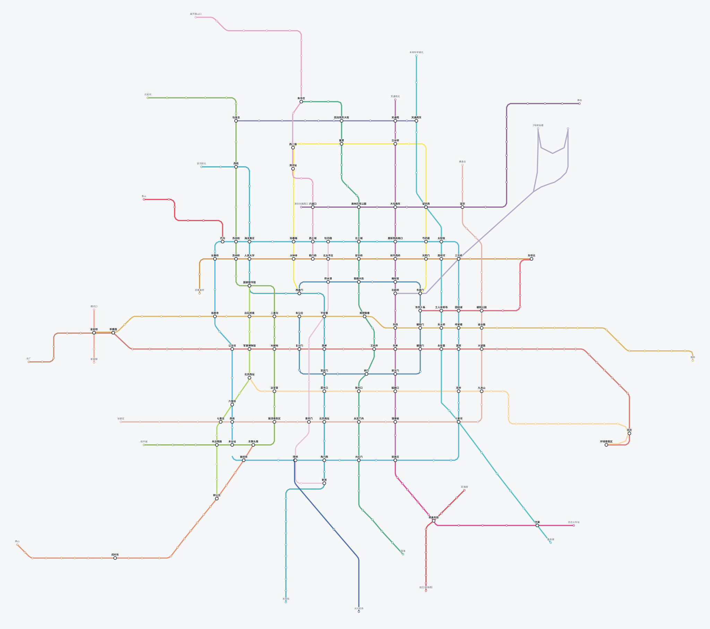

# 地铁示意图 · 本地离线数据集 / Subway Diagrams, Offline


**[English](#english) · [中文](#中文)**



---

# English

A zero-dependency static viewer that renders subway diagrams for **79 cities / 656 lines** from a
locally cached dataset. One HTML file, no build step, no framework, no CDN, no API key.

The dataset is fetched from the same JSON endpoints that Baidu Maps' subway page uses, then stored
as plain JSON under `data/`. Everything runs from disk afterwards — no network access at runtime.

## Features

| Feature | Detail |
|---|---|
| City switcher | Grouped as **Mainland China (53) / HK·MO·TW (4) / Overseas (22)**, alphabetical inside each group |
| Graceful degradation | Cities with no data are `disabled` and labelled with the reason (hover for detail) |
| Legend hover | Hovering a line dims every other line, station and label to 10–12% opacity |
| Legend click | Zooms the viewport to that line's bounding box |
| Station tooltip | Station name, interchange flag, and the upstream station `uid` |
| Pan / zoom | Mouse wheel to zoom, drag to pan |
| URL hash | Current city is mirrored to `#131`, survives reload, shareable link |
| In-memory cache | Switching back to a visited city triggers zero requests |
| Reload button | Clears the current city's cache and refetches |
| Offline guidance | Opening via `file://` shows an explanatory card instead of a blank canvas |

## Quick start

**Windows** — double-click `serve.bat`.
**macOS / Linux** — `chmod +x serve.sh && ./serve.sh`

Both start a static server on port 8000 and open the browser. Manual equivalent:

```bash
python -m http.server 8000
# then open http://localhost:8000/subway-map.html
```

> ### ⚠️ Do not double-click `subway-map.html`
>
> A `file://` page **cannot read local JSON files**. The page origin is `null`, so `fetch` on a local
> file is treated as a cross-origin request and blocked with
> `Cross origin requests are only supported for protocol schemes: http, https...`.
>
> This is a browser security policy, not a bug here. Serve the folder over HTTP instead — or inline
> the data into the HTML if you truly need a double-clickable file.
>
> If you forget anyway, the page detects `file://` and shows a guidance card with the exact command.
> It will not go blank, and it will not spam the console with CORS errors.

## Project structure

```
subway-map.html               the entire frontend: one file, no dependencies, no inlined data
serve.bat                     double-click launcher (Windows)
serve.sh                      launcher (macOS / Linux)
tools/
  fetch-subways.py            batch fetcher, Python standard library only
data/
  cities.json                 raw response of the city-list endpoint
  index.json                  manifest the page reads to enable/disable cities
  city-<code>.json            raw response per city (131 = Beijing, 289 = Shanghai, …)
docs/preview-beijing.svg      static preview image used by this README
tests/
  verify.mjs                  data layer + HTTP routes
  dom-test.mjs                real DOM run via jsdom
  file-test.mjs               file:// guidance branch
  package.json                single dev dependency: jsdom
```

## Where the data comes from

Two endpoints, reverse-engineered from `map.baidu.com/subway/`:

| Endpoint | Purpose | Output |
|---|---|---|
| `GET /?qt=subwayscity&t=<ms>` | City list that has a diagram | `data/cities.json` |
| `GET /?qt=subways&c=<code>&format=json&t=<ms>` | Lines + station geometry for one city | `data/city-<code>.json` |

**One header matters**: never send `Origin` — the upstream returns **403** immediately. The fetcher
sends a Chrome `User-Agent` plus `Referer: https://map.baidu.com/subway/`, which is stable so far.

Upstream data itself is a composite: open data and real-time feeds from municipal transport
authorities, the operating metro companies, and Baidu's own field collection (survey vehicles,
indoor backpacks, crowdsourced corrections) post-processed by AI plus human review. This repository
simply caches that publicly reachable output so it can be viewed offline and processed locally.

### Dataset at a glance

| Item | Value |
|---|---|
| Cities | 79 (79 usable / 0 empty / 0 failed) |
| Total lines | 656 |
| Payload | 4.6 MB of JSON (81 files) |
| Upstream data version | `20261012` |
| Fetch timestamp | 2026-10-15 18:07 (+08:00), 45 s |
| Largest file | New York, 273 KB |
| Smallest file | Xiangxi, 2.2 KB |
| Most lines | Guangzhou 33 / New York 32 / Seoul 30 / Beijing 28 / Shanghai 25 |

## Field reference

### `data/city-<code>.json` (raw `qt=subways` response)

```
result        { type: 920, error: 0 }          ← no data version here
subways
  ├ l[]                                        ← lines (28 for Beijing)
  │   ├ l_xmlattr { lid, lb, lc, n, loop, uid, … }
  │   └ p[]                                    ← geometry points, including non-station control points
  │       └ p_xmlattr { sid, x, y, px, py, st, ex, ln, int, uid, … }
  └ sw_xmlattr { cid, c, n, version, icon, … }
```

| Field | Meaning |
|---|---|
| `l_xmlattr.lb` / `lid` | Short line name (`Line 1`) / full name |
| `l_xmlattr.lc` | Line colour as `0xD3746E` (the page converts it to `#D3746E`) |
| `l_xmlattr.n` | Station count of that line |
| `l_xmlattr.loop` | Whether the line is a loop |
| `p_xmlattr.sid` | Station name (empty for pure control points) |
| `p_xmlattr.x` / `y` | **Diagram coordinates** — use directly as SVG coordinates (y grows southwards) |
| `p_xmlattr.px` / `py` | True Web Mercator coordinates — use these to overlay on a real map |
| `p_xmlattr.st` | `true` if this point is a station |
| `p_xmlattr.ex` | `true` if this is an interchange station |
| `p_xmlattr.uid` | Station unique id (usable for station detail or transfer queries) |
| `sw_xmlattr.version` | Geometry version hash of that city; `sw_xmlattr.cid` is the city name |

> The correlation between diagram and Mercator coordinates is **-0.981** — `x/y` are already
> screen-space values with y pointing down, so no flipping is required.

### `data/index.json` (produced by the fetcher, consumed by the page)

```json
{
  "generatedAt": "2026-10-15T18:07:11+08:00",
  "dataVersion": "20261012",
  "total": 79, "ok": 79, "empty": 0, "failed": 0,
  "cities": [
    { "code": 131, "cn_name": "北京市", "cename": "beijing", "cpre": "bj",
      "group": "国内", "file": "city-131.json", "ok": true, "reason": "",
      "lines": 28, "stations": 424, "points": 808, "bytes": 211183 }
  ]
}
```

| Field | Meaning |
|---|---|
| `group` | `国内` / `中国港澳台` / `海外` — drives the dropdown grouping |
| `ok` | Whether usable data exists; `false` disables the option in the dropdown |
| `reason` | Why it is disabled: `empty` / `http-4xx` / `timeout` / `not-json (possible captcha)` |
| `lines` / `stations` / `points` | Line count / de-duplicated station-name count / geometry point count |
| `bytes` | Size of the corresponding data file |

## Updating data

```bash
python tools/fetch-subways.py                      # all cities, existing files skipped
python tools/fetch-subways.py --only 131,289       # only the given city codes
python tools/fetch-subways.py --force              # re-download everything, incl. city list
python tools/fetch-subways.py --delay 0.8          # slow down to stay clear of rate limiting
python tools/fetch-subways.py --out D:/subway-data # write somewhere else
```

| Flag | Default | Meaning |
|---|---|---|
| `--out` | `data` | Output directory |
| `--only` | — | Comma-separated city codes |
| `--force` | off | Re-download files that already exist |
| `--delay` | `0.4` | Seconds between cities |
| `--retries` | `3` | Attempts per request, backoff `delay × 2^n` |
| `--timeout` | `20` | Per-request timeout in seconds |

Every run rewrites `data/index.json`. Empty cities and failures never abort the run — they are
summarised at the end. Afterwards, hit **Reload** in the page (or refresh it).

## Tests

```bash
# 1) static server must be running (serve.bat / serve.sh / python -m http.server 8000)
# 2) install the only dev dependency
cd tests && npm install

# 3) run
npm test              # all three suites
node verify.mjs       # data layer + HTTP routes
node dom-test.mjs     # real DOM: dropdown, rendering, switching, cache, hover, error branch
node file-test.mjs    # file:// branch: guidance card, zero requests
```

Point the suites at another port with `BASE=http://127.0.0.1:8080 node verify.mjs`.

What is asserted:

- every city's data passes the page's own `normalize()` without throwing; all colours are valid `#RRGGBB`
- **Beijing baseline: 28 lines / 808 geometry points / 425 de-duplicated stations** (unchanged across refactors)
  > Two station counts coexist and both are correct: the header shows **425**, de-duplicated by
  > `name + coordinates` (the same interchange station on different lines counts once per position),
  > while `index.json` stores **424**, de-duplicated by name only.
- dropdown has 79 options, correct group labels, defaults to Beijing with `#131`
- switching to Shanghai repaints 25 lines and fully clears the old legend; switching back is served from cache with 0 requests
- legend hover sets the target line to `opacity=0.95`, others to `0.1`, station dots to `0.12`, and restores everything on `mouseleave`
- `#99999` produces a "data file not found" card instead of a blank canvas
- `file://` shows the guidance card and issues **no** request at all

> Headless Chrome screenshots are unavailable in the environment this was built in, so the suites
> assert data correctness, DOM structure and interaction state — not pixel output. Visual polish
> (stroke weight, label density) is a human call.

## Customisation

| Want to change | Where |
|---|---|
| Default city | `const DEFAULT_CODE = 131` in `subway-map.html` |
| Port | `8000` in `serve.bat` (3 places) and in `serve.sh` (default arg) |
| Grouping rules | `HK_MO_TW` set and `group_of()` in `tools/fetch-subways.py` |
| Fetch rate / timeout | CLI flags `--delay` / `--retries` / `--timeout` |
| Colours and type scale | CSS variables in `:root` at the top of `subway-map.html` |

## Other known endpoints (not wired up)

| Endpoint | Purpose |
|---|---|
| `/?qt=bsi&c=<code>&m=sbw&ccode=<code>` | Line + station detail list; `stops[]` carries uid and lat/lng |
| `/?qt=bt&c=<code>&sn=<from>&en=<to>&m=sbw&ccode=<code>` | Transfer itinerary: time, fares, walking distance |
| `/?qt=inf&it=3&uid=<uid>&m=sbw` | Station detail (**rate-limited**; returns `anti_auth` / `need_recaptcha`) |
| `/?qt=bsl&c=<code>` | City capability flags (`sup_subway`, …) |

`sn` / `en` take the form `0$$<uid>$$<px>,<py>$$<URL-encoded station name>$$`.

## License

Code is released under the [MIT License](LICENSE). The data under `data/` and `docs/` is **not**
covered by that license — see below.

## Disclaimer

- The data belongs to Baidu Maps and its upstream providers. This repository caches it for
  **personal study and local/offline viewing** only; no redistribution rights are granted or implied.
- The fetcher already applies a 0.4 s delay and exponential backoff. **Do not raise the request
  rate**, and do not use this data commercially.
- These are internal, undocumented page endpoints. They can change or start returning a captcha at
  any time; if a URL 404s, check what the live page actually requests.

---

# 中文

一个零依赖的静态查看器：把 **79 个城市 / 656 条线路**的地铁示意图数据缓存在本地，用单个 HTML
文件渲染成可交互线路图。无构建、无框架、无 CDN、无 API Key。

数据抓自百度地图地铁页使用的同一组 JSON 接口，落盘为 `data/` 下的普通 JSON。之后全程读本地文件，
运行时不联网。

## 功能

| 功能 | 说明 |
|---|---|
| 城市切换 | 下拉按 **国内（53）/ 中国港澳台（4）/ 海外（22）** 三组排列，组内按拼音 |
| 优雅降级 | 没抓到数据的城市自动 `disabled` 并标注原因（悬停看详情） |
| 图例悬停 | 悬停任一线路 → 其余线路 / 站点 / 标注全部压暗到 10–12% |
| 图例点击 | 视角自动缩放到该线路范围 |
| 站点悬停 | 显示站名、是否换乘站、上游站点 `uid` |
| 缩放平移 | 滚轮缩放、拖拽平移 |
| URL hash | 当前城市同步到 `#131`，刷新保持，可直接分享 |
| 内存缓存 | 切回看过的城市不再发请求 |
| 重新加载 | 清掉当前城市缓存重新拉取 |
| 离线引导 | 以 `file://` 打开时弹说明卡片，而不是白屏 |

## 快速开始

**Windows** — 双击 `serve.bat`。
**macOS / Linux** — `chmod +x serve.sh && ./serve.sh`

两者都会在 8000 端口起静态服务并自动打开浏览器。手动等价命令：

```bash
python -m http.server 8000
# 然后访问 http://localhost:8000/subway-map.html
```

> ### ⚠️ 不要双击 `subway-map.html`
>
> 以 `file://` 打开时**读不到本地 JSON**。页面 origin 是 `null`，对本地文件的 `fetch` 会被当作
> 跨源请求拦截，报错为 `Cross origin requests are only supported for protocol schemes: http, https...`。
>
> 这是浏览器的安全策略，不是页面 bug。请用 HTTP 服务打开；如果你确实需要双击可用，只能把数据
> 内联进 HTML。
>
> 真忘了也没事——页面会检测到 `file://` 并弹出引导卡片写明原因和命令，不会白屏，也不会刷一屏
> CORS 报错。

## 目录结构

```
subway-map.html               全部前端：单文件、零依赖、零内联数据
serve.bat                     双击启动（Windows）
serve.sh                      启动脚本（macOS / Linux）
tools/
  fetch-subways.py            批量抓取器，纯 Python 标准库
data/
  cities.json                 城市列表接口的原始响应
  index.json                  抓取清单，页面靠它决定哪些城市可选 / 置灰
  city-<code>.json            单个城市的原始响应（131 = 北京，289 = 上海 …）
docs/preview-beijing.svg      README 用的静态预览图
tests/
  verify.mjs                  数据层 + HTTP 路由
  dom-test.mjs                用 jsdom 真跑页面
  file-test.mjs               file:// 引导分支
  package.json                唯一的开发依赖：jsdom
```

## 数据从哪来

两个接口，逆向自 `map.baidu.com/subway/`：

| 接口 | 用途 | 落盘文件 |
|---|---|---|
| `GET /?qt=subwayscity&t=<ms>` | 有地铁示意图的城市列表 | `data/cities.json` |
| `GET /?qt=subways&c=<code>&format=json&t=<ms>` | 某城市的线路 + 站点几何 | `data/city-<code>.json` |

**有一个请求头必须注意**：绝不能带 `Origin`，带上游直接返回 **403**。抓取器用 Chrome
`User-Agent` 加 `Referer: https://map.baidu.com/subway/`，实测稳定。

上游数据本身是混合来源：政府交通主管部门的开放数据与实时对接、地铁运营方，以及百度自采
（采集车 / 室内背包 / 众包纠错）再经 AI + 人工审核加工。本仓库只是把这份公开可访问的输出缓存
到本地，方便离线查看和做二次处理。

### 当前数据集

| 项目 | 值 |
|---|---|
| 城市数 | 79（可用 79 / 空数据 0 / 失败 0） |
| 线路总数 | 656 |
| 数据体积 | 4.6 MB JSON（81 个文件） |
| 接口数据版本 | `20261012` |
| 抓取时间 | 2026-10-15 18:07（+08:00），用时 45 秒 |
| 最大文件 | 纽约 273 KB |
| 最小文件 | 湘西土家族苗族自治州 2.2 KB |
| 线路最多 | 广州 33 / 纽约 32 / 首尔 30 / 北京 28 / 上海 25 |

## 字段说明

### `data/city-<code>.json`（`qt=subways` 的原始响应）

```
result        { type: 920, error: 0 }          ← 这里没有数据版本号
subways
  ├ l[]                                        ← 线路数组（北京 28 条）
  │   ├ l_xmlattr { lid, lb, lc, n, loop, uid, … }
  │   └ p[]                                    ← 该线几何点，含非站点的折线控制点
  │       └ p_xmlattr { sid, x, y, px, py, st, ex, ln, int, uid, … }
  └ sw_xmlattr { cid, c, n, version, icon, … }
```

| 字段 | 含义 |
|---|---|
| `l_xmlattr.lb` / `lid` | 线路简称（`1号线`）/ 完整名 |
| `l_xmlattr.lc` | 线路颜色，形如 `0xD3746E`（页面转成 `#D3746E`） |
| `l_xmlattr.n` | 该线站点数 |
| `l_xmlattr.loop` | 是否环线 |
| `p_xmlattr.sid` | 站名（纯控制点为空） |
| `p_xmlattr.x` / `y` | **示意图坐标**，可直接当 SVG 坐标用（y 轴向下） |
| `p_xmlattr.px` / `py` | 真实墨卡托坐标，想叠到真地图上用这两个 |
| `p_xmlattr.st` | 是否站点（`false` 表示只是折线控制点） |
| `p_xmlattr.ex` | 是否换乘站 |
| `p_xmlattr.uid` | 站点唯一 id（可用于查详情、算换乘） |
| `sw_xmlattr.version` | 该城市图形的版本哈希；`sw_xmlattr.cid` 是城市名 |

> 示意图坐标与墨卡托坐标的相关系数是 **-0.981**，也就是 `x/y` 就是给 SVG 用的屏幕坐标
> （y 向下 = 南），不用做任何翻转。

### `data/index.json`（抓取器产出，页面消费）

```json
{
  "generatedAt": "2026-10-15T18:07:11+08:00",
  "dataVersion": "20261012",
  "total": 79, "ok": 79, "empty": 0, "failed": 0,
  "cities": [
    { "code": 131, "cn_name": "北京市", "cename": "beijing", "cpre": "bj",
      "group": "国内", "file": "city-131.json", "ok": true, "reason": "",
      "lines": 28, "stations": 424, "points": 808, "bytes": 211183 }
  ]
}
```

| 字段 | 说明 |
|---|---|
| `group` | `国内` / `中国港澳台` / `海外`，页面分组用 |
| `ok` | 是否有可用数据；`false` 的城市在下拉里置灰 |
| `reason` | 置灰原因：`empty` / `http-4xx` / `timeout` / `not-json（可能触发人机验证）` |
| `lines` / `stations` / `points` | 线路数 / 去重站名数 / 几何点数 |
| `bytes` | 对应数据文件大小 |

## 更新数据

```bash
python tools/fetch-subways.py                      # 全量（已存在的自动跳过）
python tools/fetch-subways.py --only 131,289       # 只抓指定城市
python tools/fetch-subways.py --force              # 全部重下（含城市列表）
python tools/fetch-subways.py --delay 0.8          # 放慢间隔，避免触发风控
python tools/fetch-subways.py --out D:/subway-data # 落到别的目录
```

| 参数 | 默认 | 说明 |
|---|---|---|
| `--out` | `data` | 输出目录 |
| `--only` | 空 | 只抓这些城市 code，逗号分隔 |
| `--force` | 关 | 已存在的文件也重新下载 |
| `--delay` | `0.4` | 城与城之间的间隔秒数 |
| `--retries` | `3` | 单次请求最大尝试次数（失败按 `delay × 2^n` 退避） |
| `--timeout` | `20` | 单次请求超时秒数 |

每次运行都会重写 `data/index.json`。**空数据和失败的城市不会中断整个流程**，只会在结尾汇总打印。
抓完数据后刷新页面，或点右上角「重新加载」。

## 测试

```bash
# 1) 先在项目根目录起静态服务（serve.bat / serve.sh / python -m http.server 8000）
# 2) 装唯一的开发依赖
cd tests && npm install

# 3) 跑
npm test              # 三组全跑
node verify.mjs       # 数据层 + HTTP 路由
node dom-test.mjs     # 真实 DOM：下拉、渲染、切换、缓存、悬停、错误分支
node file-test.mjs    # file:// 分支：引导层、零请求
```

换端口用 `BASE=http://127.0.0.1:8080 node verify.mjs`。

覆盖的关键断言：

- 所有城市数据都能过页面自己的 `normalize()` 不抛错，颜色全为合法 `#RRGGBB`
- **北京基线：28 线 / 808 个几何点 / 425 个去重站点**（重构前后保持一致）
  > 两个站点口径并存且都正确：顶栏的 **425** 按「站名 + 坐标」去重（同名换乘站在不同线路各算一次
  > 位置），`index.json` 里的 **424** 按站名去重。
- 下拉 79 项、分组标签正确、默认北京且 hash = `#131`
- 切上海 → 重绘 25 线并完全清空旧图例；切回北京 → 命中缓存、0 次请求
- 图例悬停 → 目标线 `opacity=0.95`、其余 `0.1`、站点 `0.12`，移开后全部复原
- `#99999` → 弹「找不到该城市的数据文件」而不是白屏
- `file://` → 弹引导层，且**一个请求都不发**

> 构建环境里拿不到无头 Chrome 截图输出，所以测试断言的是数据正确性、DOM 结构与交互状态，
> 不包含像素级校验。观感层面（线宽、标注疏密）需要人工在浏览器确认。

## 自定义

| 想改什么 | 改哪里 |
|---|---|
| 默认打开的城市 | `subway-map.html` 里的 `const DEFAULT_CODE = 131` |
| 端口 | `serve.bat` 里的 `8000`（3 处）、`serve.sh` 的默认参数 |
| 分组规则 | `tools/fetch-subways.py` 的 `HK_MO_TW` 集合与 `group_of()` |
| 抓取间隔 / 超时 | 命令行参数 `--delay` / `--retries` / `--timeout` |
| 配色与字号 | `subway-map.html` 顶部 `:root` 里的 CSS 变量 |

## 其他已知接口（暂未接入）

| 接口 | 用途 |
|---|---|
| `/?qt=bsi&c=<code>&m=sbw&ccode=<code>` | 线路 + 站点明细清单，`stops[]` 里带 uid 和经纬度 |
| `/?qt=bt&c=<code>&sn=<起>&en=<止>&m=sbw&ccode=<code>` | 换乘方案，返回时间 / 票价 / 步行距离 |
| `/?qt=inf&it=3&uid=<uid>&m=sbw` | 站点详情（**有风控**，返回 `anti_auth` / `need_recaptcha`） |
| `/?qt=bsl&c=<code>` | 城市能力位（`sup_subway` 等） |

`sn` / `en` 的格式是 `0$$<uid>$$<px>,<py>$$<URL 编码的站名>$$`。

## 许可

代码以 [MIT License](LICENSE) 发布。`data/` 与 `docs/` 下的数据**不在**该许可覆盖范围内，见下。

## 免责声明

- 数据版权归百度地图及原始提供方所有。本仓库仅作**个人学习与本地离线查看**用途，不授予也不暗示
  任何再分发权利。
- 抓取器已带 0.4 秒间隔与指数退避，**请勿提高请求频率**，勿用于商业分发。
- 这些是页面内部未公开接口，随时可能变更或开始返回人机验证；链接失效时以页面实际请求为准。
